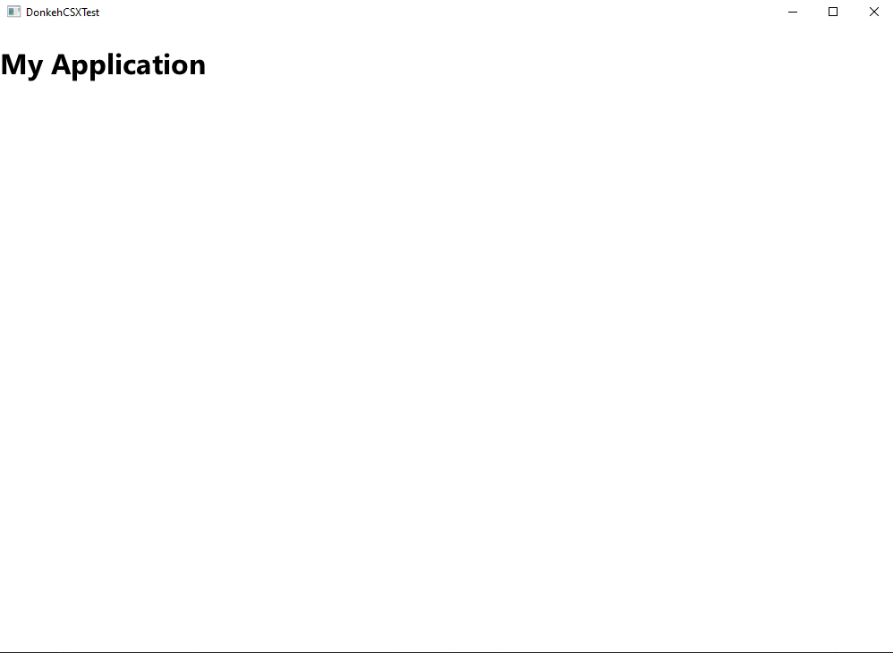

# DonkehCSXTest

A small DonkehUI application written with CSX. The component below is declared in
`Program.cx` and rendered through the generated build in `src/generated`.




## Getting started

DonkehUI is about to get even easier: with the new `csx` tooling you can go from
`.cx` source to a running window in one step.

```bash
# Transform .cx files and run the app
csx run

# Or just build
csx build
```

If you prefer the classic flow, the generated C# lives in `src/generated` and the
project builds with the normal .NET tooling:

```bash
dotnet run
```

## Embedding CSS into the assembly

Donkeh stylesheets are embedded as resources and registered with an assembly
attribute. Add the CSS files as `EmbeddedResource` items in your `.csproj`:

```xml
<ItemGroup>
  <EmbeddedResource Include="src/Components/**/*.css" />
</ItemGroup>
```

Then declare the stylesheet on the assembly (usually at the top of the component
file):

```csharp
[assembly: Stylesheet("src/Components/Header/Header.css")]
```

This keeps the CSS inside the built assembly so the app can ship as a single
binary.