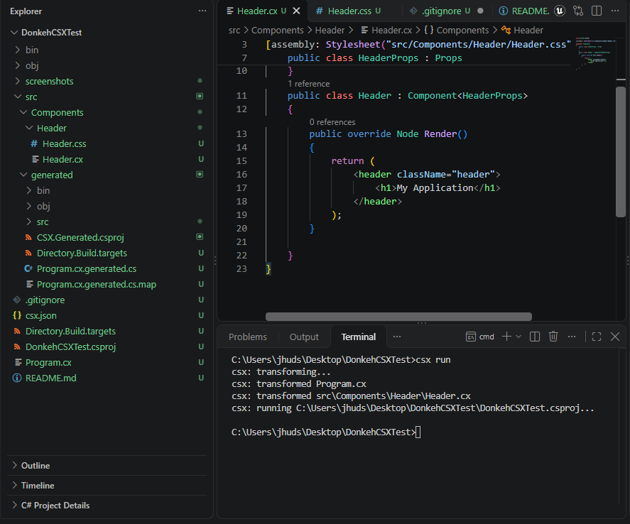

# DonkehCSXTest

A small DonkehUI application built with CSX. Components are written in `.cx` files and transformed into C# using the configuration specified in `csx.json`.





## Getting started

### Requirements

- .NET 10 SDK
- **CSX.CliTool** `1.0.3` – Transforms `.cx` files and provides CSX tooling.
- **Donkeh.CliTool** `1.0.47` – Provides Donkeh project tooling.

Install both global tools:

```
dotnet tool install --global CSX.CliTool --version 1.0.3
dotnet tool install --global Donkeh.CliTool --version 1.0.47
```

If already installed, use `dotnet tool update` instead.

Verify installation:

```
csx --help
donkeh --help
```

### Editor support (optional)

Install CSX language support for your editor:

```
csx enable vscode
# or
csx enable rider
```

Restart your editor after installation.

### Run the application

```
csx run
```

This transforms the `.cx` source files into C# according to `csx.json`, then builds and launches the application.

Other commands:

```
csx build    # Transform and compile without launching
dotnet run   # Run using the existing generated C#
```

After editing `.cx` files, run `csx build` or `csx run` to regenerate the C# source.

### Additional Donkeh commands

```
donkeh new project MyApp --csx
donkeh new component Header --project .
donkeh enable-target android
donkeh enable-feature hot-reload
donkeh watch
```

### Troubleshooting

If `csx` or `donkeh` isn't recognised, ensure `%USERPROFILE%\.dotnet\tools` is on your `PATH`, then restart your terminal.

List installed global tools with:

```
dotnet tool list --global
```

## Documentation

For DonkehUI features, components, styling and project configuration, see the [DonkehUI documentation](https://barely-sentient.github.io/donkeh-ui).